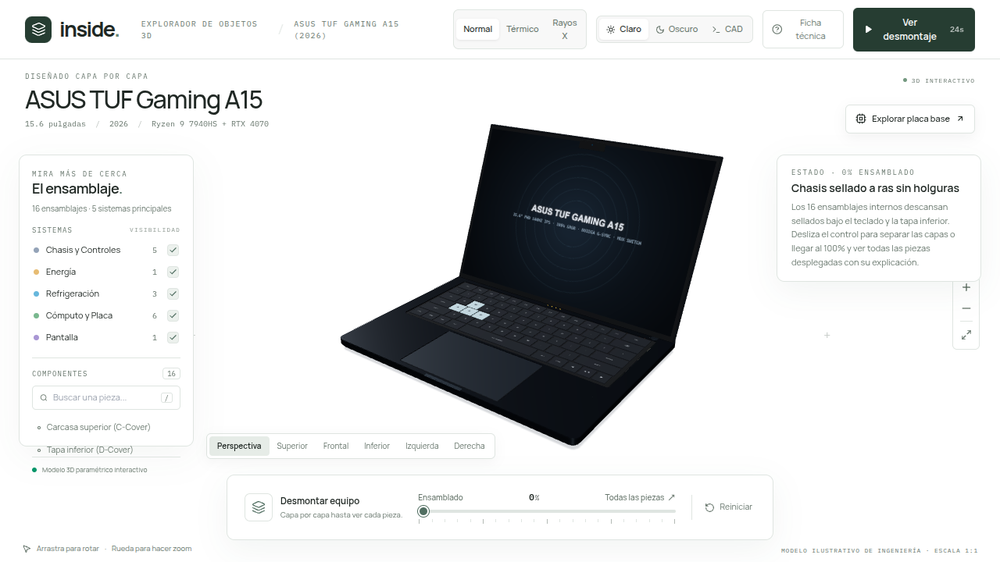
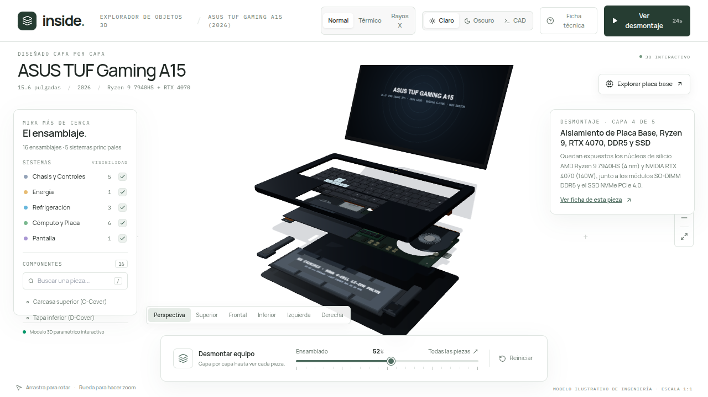
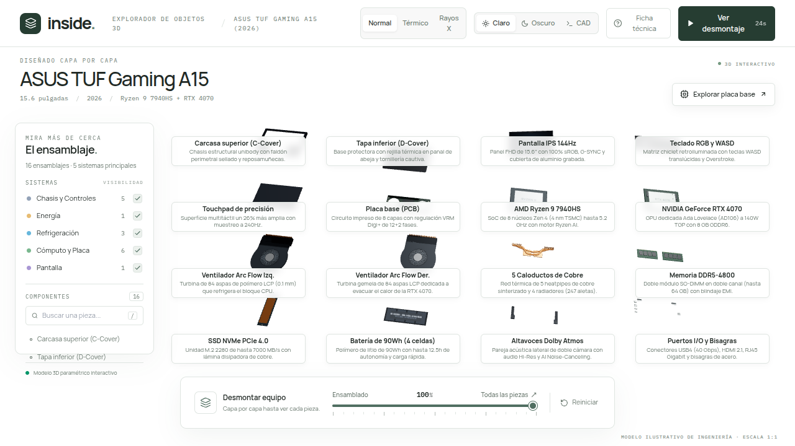
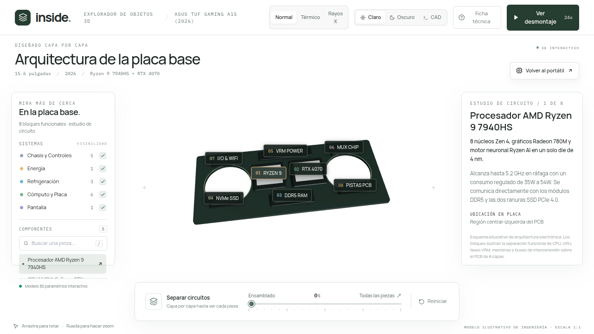

# ASUS TUF Gaming A15 — 3D Hardware Teardown & Knolling Explorer

> 🌐 **Live Interactive 3D Demo:** [https://ismael-sallami.github.io/asus-tuf-a15-3d/](https://ismael-sallami.github.io/asus-tuf-a15-3d/)


[](https://threejs.org/)
[](https://www.khronos.org/webgl/)
[](https://react.dev/)
[](https://www.typescriptlang.org/)
[](https://tailwindcss.com/)
[](https://en.wikipedia.org/wiki/MIL-STD-810)

An interactive 3D hardware teardown, component-level knolling inventory, and logic board architecture explorer for the **ASUS TUF Gaming A15 (FA507)**. Built from the ground up with Three.js, React 18, and TypeScript, it decomposes the laptop into **16 self-contained 3D subsystems** and **8 logic board functional blocks**, smoothly transitioning from a flush sealed chassis (`0%`), through a layered mechanical explosion (`1%–65%`) with live stage explanations, into an orthonormalized **4 × 4 Knolling Inventory Grid** (`65%–100%`) where every 3D part aligns above its technical explanation card.

## Key Engineering Features

### 1. Three-Stage Parametric Disassembly (`0% → 65% → 100%`)
- **0% — Hermetically Sealed Chassis:** At `0%`, the top deck (`C-Cover`) and bottom service plate (`D-Cover`) close flush around the internal stack (`Y = ±0.06`), keeping the Arc Flow turbines, copper heatpipes, and logic board completely enclosed inside the chassis.
- **1% to 65% — Layered Mechanical Separation with Live Explanations:** As the teardown slider advances, each of the 16 subsystems separates along its mechanical extraction vector (`at: [start, end]` and `spread: [dx, dy, dz]`) while a live stage banner explains the active extraction step and lists the parts emerging in that range.
- **65% to 100% — 4 × 4 Knolling Inventory Grid ("Todas las piezas"):** Approaching `100%`, the camera interpolates to a frontal frustum plane (`fov = 36°`, `Z = 15.3884`) where the `Z = 0` plane has exact height `10.0` and width `10.0 × aspect`. All 16 3D parts smoothly rotate to face the viewer, scale to fit their cell (`sizeSpan`), and align directly above a `4 × 4` CSS grid of technical explanation cards.

### 2. 16 Modular 3D Subsystems
Every component is modeled as an independent `THREE.Group` centered at its local `(0, 0, 0)` origin, supporting raycast selection, 3D pin projection, and single-part 3D isolation:
1. **Chasis superior (C-Cover)** — Brushed aluminum-magnesium deck with machined recesses for the keyboard and trackpad.
2. **Cubierta inferior (D-Cover)** — Service plate with hexagonal intake vents, rubber feet, and 12 captive Phillips screws.
3. **Pantalla FHD 144Hz** — 15.6" IPS-level panel with Adaptive-Sync and slim bezels.
4. **Teclado RGB Overstroke** — Full-size membrane switch matrix with translucent smoked WASD keycaps and key legends.
5. **Trackpad de precisión** — Mylar multi-touch surface with integrated Hall-effect click sensor.
6. **Placa base (PCB)** — 8-layer FR-4 matte-black mainboard with copper power planes and SMD components.
7. **AMD Ryzen 9 7940HS** — Zen 4 (4nm TSMC) processor package with exposed rectangular silicon die and SMD capacitors.
8. **NVIDIA RTX 4060** — AD107 (140W TGP + MUX Switch) graphics processor ringed by 4 GDDR6 memory packages.
9. **Turbina Arc Flow Izq. (CPU)** — 84-blade liquid-crystal polymer centrifugal fan housing.
10. **Turbina Arc Flow Der. (GPU)** — Dedicated 84-blade centrifugal fan for GPU and VRAM cooling.
11. **Disipador de 5 Heatpipes** — Five sintered-copper heatpipes bridging CPU, GPU, and VRM thermal blocks to 4 fin stacks.
12. **Memoria DDR5-4800** — Dual-channel SO-DIMM modules (2 × 16 GB) with gold edge fingers and DRAM ICs.
13. **SSD NVMe PCIe 4.0** — M.2 2280 solid-state drive with PCIe 4.0 x4 controller, NAND packages, and copper thermal pad.
14. **Batería 90Wh (4 celdas)** — 4S1P lithium-ion polymer pack occupying the full front palmrest bay.
15. **Altavoces Dolby Atmos** — Dual acoustic suspension chambers with side-firing ports.
16. **Bisagras y puertos I/O** — High-torque steel hinges alongside RJ45, HDMI 2.1, USB4, USB-C, and 3.5mm audio shields.

### 3. Interactive Logic Board Explorer (`01` to `08`)
Clicking **"Explorar placa base"** isolates a dedicated high-detail 3D model of the mainboard with 8 numbered hardware pins projected in real time onto the viewport:
- `01 RYZEN 9` — Socket FP8 & Zen 4 package
- `02 RTX 4060` — BGA GPU & 8 GB GDDR6 bank
- `03 VRM 12+2` — Monolithic DrMOS power stages & alloy chokes
- `04 DDR5-4800` — Dual-channel SO-DIMM slots
- `05 NVME RAID` — Dual M.2 PCIe 4.0 x4 slots with MUX routing
- `06 WIFI 6 + EC` — M.2 2230 wireless card & Embedded Controller
- `07 I/O SUR` — Audio DAC, battery connector & speaker headers
- `08 PISTAS PCB` — High-speed differential pairs & impedance-matched traces

### 4. Three Visual Themes & Full Mobile Adaptation
- **Themes:** Instant switching between **Claro** (Editorial Studio Paper), **Oscuro** (Cyber TUF Dark), and **CAD** (Engineering Blueprint).
- **Responsive Mobile Layout:** Dedicated slide-over parts drawer (`Piezas (16)`), adaptive 3D Knolling cell scaling for portrait screens, and docked bottom inspector cards.

## Screenshots

| Sealed Chassis (`0%`) | Layered Teardown (`50%`) |
| :---: | :---: |
|  |  |

| 4 × 4 Knolling Inventory (`100%`) | Logic Board Explorer (`01–08`) |
| :---: | :---: |
|  |  |

## Quick Start

```bash
git clone https://github.com/Ismael-Sallami/asus-tuf-a15-3d.git
cd asus-tuf-a15-3d
npm install
npm run dev
```

Build for production:

```bash
npm run build
npm run preview
```

## License
Distributed under the MIT License. See [LICENSE](LICENSE) for details.
