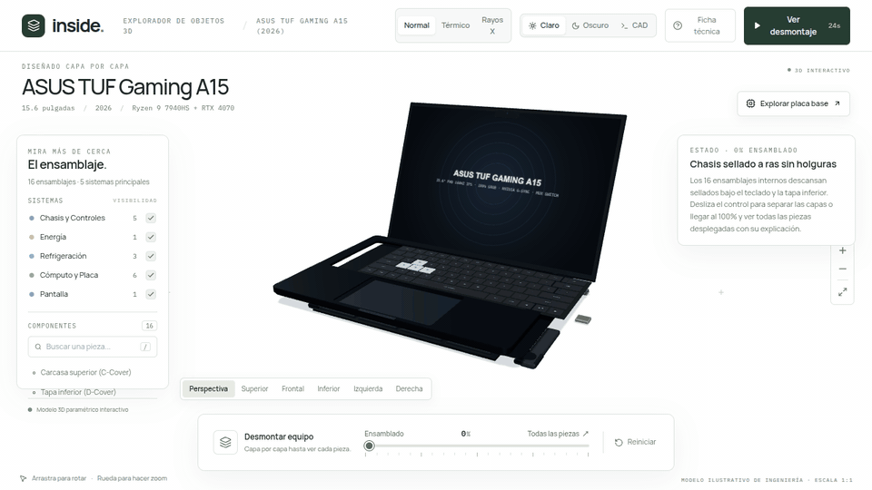

# ASUS TUF Gaming A15 — 3D Hardware Teardown & Scrollytelling Experience



[](https://threejs.org/)
[](https://www.khronos.org/webgl/)
[](https://react.dev/)
[](https://www.typescriptlang.org/)
[](https://greensock.com/gsap/)
[](https://tailwindcss.com/)
[](https://en.wikipedia.org/wiki/MIL-STD-810)

An interactive, high-fidelity 3D scrollytelling laboratory showcasing the internal architecture and thermal engineering of the ASUS TUF Gaming A15 (FA507). Built with Three.js, React, TypeScript, and GSAP ScrollTrigger, this project delivers a smooth 60 FPS exploded-view teardown of every subsystem, synchronized with real-time telemetry and procedural audio synthesis.

## Engineering Highlights

### Parametric Hardware Decomposition
The 3D model decouples the physical chassis into independently translated mechanical layers along the vertical axis, preserving mechanical clearances and realistic disassembly hierarchy:
- **D-Cover Base Plate:** High-density polymer lower chassis with molded honeycomb ventilation intakes, anti-slip rubber feet, and perimeter captive screws.
- **90Wh High-Capacity Battery:** 4-cell Lithium-ion pack (15.4V, 5845mAh) with integrated management circuitry and braided wiring harness.
- **Precision Audio Modules:** Dual side-firing stereo speaker acoustic chambers with rubber vibration dampers.
- **Motherboard PCB:** High-density matte-black circuit board featuring procedurally generated multi-layer copper traces, surface-mount components, and VRM power delivery phases.
- **Core Silicon Dies:** Bare-die AMD Ryzen 7 7735HS processor and NVIDIA GeForce RTX 4060 Laptop GPU with mirror-finish silicon surfaces and perimeter decoupling capacitors.
- **Memory & Storage Subsystem:** Dual SO-DIMM DDR5-4800 memory modules with metallic heatspreaders, alongside a primary PCIe 4.0 NVMe M.2 SSD under a dedicated thermal sink and an accessible M.2 expansion slot.
- **Cooling Assembly:** Four sintered-copper composite heatpipes connected to quad finned heatsink stacks and dual Arc Flow fans featuring 84 aerodynamically tapered blades (0.1mm thin at tips). Includes animated particle emitters simulating hot exhaust dissipation.
- **C-Cover Keyboard Deck:** Brushed-finish upper chassis, integrated multi-touch trackpad, numeric keypad, and iconic translucent smoked WASD keycaps.
- **15.6" Display Assembly:** 144Hz Full HD IPS panel housed in a reinforced lid with laser-etched TUF emblem and dual zinc-alloy friction hinges.

### Armoury Crate Telemetry HUD
A tactical on-screen heads-up display replicates the ASUS Armoury Crate monitoring environment:
- **Circular Fan Tachometer:** Dynamic SVG gauge computing live turbine velocity from 2,400 to 5,800 RPM.
- **Thermal Monitors:** Calibrated gauges tracking CPU and GPU die temperatures in real time based on workload profiles.
- **Acoustic Presets:** Direct profile selector toggleable between Silent (2,400 RPM / low dBA), Performance (3,800 RPM / balanced), and Turbo (5,800 RPM / maximum airflow).
- **Direct Layer Navigation:** Quick-access buttons to focus and explode specific hardware subsystems with cinematic camera framing.

### Viewport Shading Modes & Inspection
- **Normal PBR:** Full physically based rendering pipeline utilizing ACES Filmic tone mapping, normal maps, roughness distributions, and calibrated TUF dual rim lights (Amber #FFB800 and Cyan #00E5FF).
- **FLIR Thermal Vision:** Custom GLSL-equivalent heat mapping converting component surface coordinates into a high-contrast infrared thermal spectrum (ranging from deep blue ambient to white-hot silicon junction points).
- **X-Ray Holographic:** Translucent blueprint wireframe rendering with depth write isolation and glowing cyan contours for internal structural inspection.
- **360° Free Orbit Controls:** Instant toggle switching the camera from rigid scrollytelling pathing into unrestricted orbital rotation with inertia damping.

### Procedural Sound Synthesis (Web Audio API)
Zero external audio files or network payloads. All auditory feedback is synthesized directly on the Web Audio API audio graph:
- **Mechanical Clicks:** Dual-stage oscillator transients simulating tactile microswitch actuation on clicks and toggles.
- **Turbine Jet Whine:** Bandpass-filtered white noise combined with sine harmonics that pitch-shift smoothly with fan RPM changes.
- **Sub-bass Resonances:** Short sub-bass pulse waves signaling phase transitions and component inspections.

### Contact Shadows & Cinematic Camera Smoothing
- **Shadow Grounding:** A multi-layered tactical pedestal featuring an engineered dark cylinder with receiveShadow, an overlay ShadowMaterial plane, and technical alignment rings to ground every detached part with realistic soft contact shadows.
- **Framerate-Independent Damping:** Camera scroll tracking uses exponential vector damping (1 - Math.exp(-20 * dt)), eliminating micro-stutters and input lag to sustain buttery 60 FPS motion across variable refresh rates.

## Architecture & Project Structure

```
asus-tuf-a15-3d/
├── assets/
│   └── teardown-demo.gif         # High-resolution dual-palette teardown animation
├── src/
│   ├── components/
│   │   ├── ArmouryCrateHUD.tsx   # Floating telemetry HUD, RPM gauge & thermal profiles
│   │   ├── ComponentModal.tsx    # Technical engineering modal with deep component specs
│   │   ├── HeaderNav.tsx         # Navigation bar with view modes and inspection toggles
│   │   └── ScrollStorySections.tsx # Scrollytelling overlay content & phase triggers
│   ├── data/
│   │   └── laptopSpecs.ts        # Hardware specifications, military tolerances & specs
│   ├── three/
│   │   ├── LaptopModel.ts        # Parametric 3D laptop geometry, shaders & exploded groups
│   │   ├── proceduralTextures.ts # Canvas 2D procedural generators (PCB, honeycombs, displays)
│   │   └── SceneManager.ts       # Three.js lifecycle, ACES tone mapping, shadows & controls
│   ├── types/
│   │   └── laptop.ts             # TypeScript definitions for components, phases & modes
│   ├── utils/
│   │   └── soundEffects.ts       # Procedural Web Audio API sound synthesizer
│   ├── App.tsx                   # Master orchestrator syncing GSAP ScrollTrigger & Three.js
│   ├── index.css                 # Custom font imports (Rajdhani, JetBrains Mono) & styles
│   └── main.tsx                  # React 18 bootstrap entry point
├── index.html                    # Root HTML shell with military cyberpunk meta tags
├── package.json                  # Dependencies & execution scripts
├── tailwind.config.js            # Design tokens & color system
├── tsconfig.json                 # TypeScript compiler configuration
└── vite.config.ts                # Vite bundler configuration
```

## Quick Start

### Prerequisites
- Node.js 18+ or 20+
- npm, pnpm, or yarn

### Installation
```bash
# Clone the repository
git clone https://github.com/Ismael-Sallami/asus-tuf-a15-3d.git

# Navigate into project directory
cd asus-tuf-a15-3d

# Install dependencies
npm install
```

### Development
```bash
# Start local Vite development server
npm run dev
```
Open `http://localhost:5173` in your browser.

### Production Build
```bash
# Typecheck with tsc and compile optimized production bundles
npm run build

# Preview production build locally
npm run preview
```

## Hardware Specifications Referenced

| Subsystem | Specification |
| :--- | :--- |
| **Processor** | AMD Ryzen 7 7735HS (8 Cores, 16 Threads, up to 4.75 GHz, Zen 3+) |
| **Graphics** | NVIDIA GeForce RTX 4060 Laptop GPU (8GB GDDR6, 140W TGP with Dynamic Boost) |
| **Cooling** | Dual 84-blade Arc Flow Fans, 4 Copper Heatpipes, 4 Exhaust Heatsinks |
| **Memory** | 16GB / 32GB Dual-Channel DDR5-4800 SO-DIMM |
| **Storage** | 512GB / 1TB PCIe 4.0 NVMe M.2 SSD + Secondary Empty M.2 Slot |
| **Display** | 15.6" FHD (1920x1080) 144Hz IPS-level, G-Sync, 100% sRGB |
| **Battery** | 90Wh 4-Cell Lithium-ion (15.4V, Fast Charging 50% in 30 mins) |
| **Durability** | MIL-STD-810H Military Standard (Shock, Vibration, Temperature, Humidity) |

## License
Distributed under the MIT License. See `LICENSE` for details.

## Author
**Ismael Sallami Moreno**
- Portfolio: [https://ismael-sallami.github.io](https://ismael-sallami.github.io)
- GitHub: [@ismael-sallami](https://github.com/ismael-sallami)
